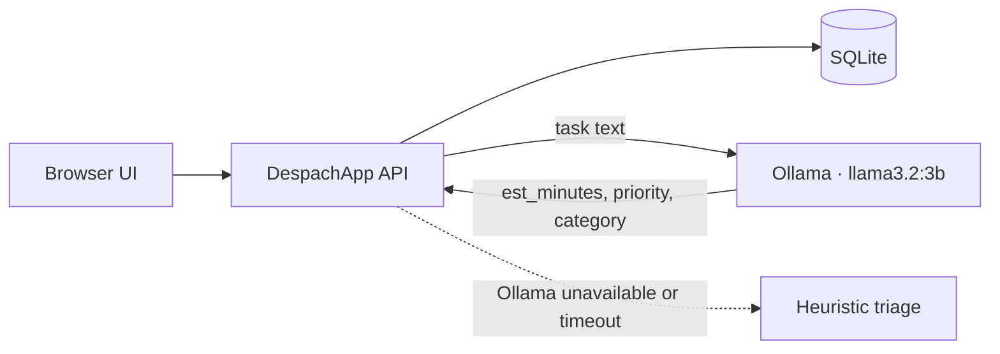

# DespachApp

> **EN:** Self-hosted task dispatcher inspired by operating-system scheduling: LIFO stack, SJF/SRTF queue and priorities, with local LLM triage (Ollama).
> **ES:** Despachador de tareas autoalojado inspirado en la planificación de sistemas operativos: pila LIFO, cola SJF/SRTF y prioridades, con triage por IA local (Ollama).
>
> **v0.2.1.2** · FastAPI + SQLite · dictado por voz con respaldo offline · Licencia MIT

[English](#english) · [Español](#español)

<!-- TODO: add a screenshot or GIF here / agregar captura o GIF aquí -->
<!--  -->

---

## English

### What it is

DespachApp organizes your daily to-dos using data structures and scheduling algorithms from operating systems. The name comes from the OS *dispatcher* (*despachador*): the component that decides which process runs next.

- **LIFO stack** — a new task is pushed on top; the latest arrival is the first one released (`push` / `pop`).
- **SJF (Shortest Job First)** — the queue is reordered so the task with the shortest estimated duration runs first, minimizing the average waiting time.
- **SRTF (Shortest Remaining Time First, preemptive)** — pick a task as "in progress"; if a new task is shorter than the remaining time of the current one, it preempts it. The interrupted task returns to the queue keeping its remaining time (`estimated − worked`, credited on pause or completion).
- **Priority** — urgent tasks go to the top; within the same level, LIFO.
- **Completed-tasks archive** — when finished, a task leaves the queue and is archived with a timestamp.
- **Local AI triage** — [Ollama](https://ollama.com) with `llama3.2:3b` estimates duration, priority and category for each task. If Ollama does not respond, a built-in heuristic triage keeps the app working.

Everything runs locally (or self-hosted with Docker). Data lives in a single SQLite file: no accounts, no cloud.

### Quick start

**Option A — Docker (app + Ollama, all included)**

```bash
docker compose up -d --build
# first time only: download the triage model
docker compose exec ollama ollama pull llama3.2:3b
```

Open <http://localhost:8000>.

> Already running Ollama on your machine? Edit `docker-compose.yml`, set `OLLAMA_URL=http://host.docker.internal:11434` and remove the `ollama` service.

**Option B — Local, without Docker**

```bash
cd despachapp
python -m venv .venv

# Windows
.venv\Scripts\pip install -r requirements.txt
.venv\Scripts\uvicorn app.main:app --port 8000

# Linux / macOS
.venv/bin/pip install -r requirements.txt
.venv/bin/uvicorn app.main:app --port 8000
```

Stack: **Python + FastAPI + SQLite** — the web server is FastAPI (uvicorn); no other services required.

> Voice dictation uses a local **faster-whisper** fallback (already in `requirements.txt`).
> If you hit the known PyAV 19 ↔ faster-whisper 1.2.1 conflict, run once:
> `python scripts/fix_av19_patch.py`.

If Ollama is running (`ollama serve` and `ollama pull llama3.2:3b`), AI triage works right away. If not, the app falls back to heuristic triage.

### Configuration

| Variable | Default | Description |
|---|---|---|
| `DATA_DIR` | `./data` | Folder for the SQLite file (`despachapp.db`). |
| `OLLAMA_URL` | `http://localhost:11434` | Ollama endpoint. |
| `OLLAMA_MODEL` | `llama3.2:3b` | Model used for triage. |
| `OLLAMA_TIMEOUT` | `60` | Maximum seconds per triage request. |

### How triage works

Each new task (or the **✦ Triage** button) sends the title and details to the LLM, which returns JSON with:

- `est_minutes`: 5–480 minutes — feeds the SJF mode.
- `priority`: 1 high / 2 medium / 3 low — feeds the Priority mode.
- `category`: work, home, shopping, etc.

The origin of each triage is labelled on the task card: **AI** (Ollama), **heuristic estimate** (fallback without LLM) or **manual** (adjusted by you).

### Architecture



### API (for scripts and automation)

| Method | Route | Action |
|---|---|---|
| `GET` | `/health` | Simple liveness check (for monitors). |
| `GET` | `/api/state` | Full state (config, queue, etc.). |
| `POST` | `/api/tasks` | Push a task `{title, description}`. |
| `PATCH` | `/api/tasks/{id}` | Edit estimate, priority, etc. |
| `POST` | `/api/tasks/{id}/complete` | Move it to the completed archive. |
| `POST` | `/api/tasks/{id}/start` | Mark it "in progress" (preempts another one). |
| `POST` | `/api/tasks/{id}/pause` | Return it to the queue with its remaining time. |
| `POST` | `/api/tasks/{id}/triage` | Recompute with AI. |
| `DELETE` | `/api/tasks/{id}` | Delete it. |
| `POST` | `/api/settings` | `{mode: "lifo" / "sjf" / "srtf" / "prioridad"}` or `{auto_triage: bool}`. |

### Design notes

- **Why SJF?** It minimizes the queue's average waiting time; clearing short tasks quickly frees mental space.
- **Why LIFO?** Recent tasks usually carry fresh context, and the push/pop philosophy discourages piling up unprocessed items.
- **Why preemptive SRTF?** Interrupting a long running task for shorter ones minimizes total waiting time. You still decide when to start each task, and preemption only reorders: it never discards work, since the interrupted task keeps its remaining time.
- One data file, no accounts, no cloud. Backups = copy `data/`.

### Limitations

- Single-user design with no authentication. Use it on localhost or a private network, and put it behind a reverse proxy with authentication if you expose it.
- Triage quality depends on the local model; the heuristic fallback is approximate by design.

### Roadmap

- [ ] Automated tests for the scheduling logic (SJF, SRTF, priority).
- [ ] CI with GitHub Actions (lint, tests, Docker build).
- [ ] Published container image.
- [ ] Healthcheck in `docker-compose.yml`.

### License

MIT — see [LICENSE](LICENSE).

---

## Español

### Qué es

DespachApp organiza tus pendientes diarios con estructuras de datos y algoritmos de planificación de sistemas operativos. El nombre viene del *despachador* (*dispatcher*) del SO: el componente que decide qué proceso se ejecuta a continuación.

- **Pila LIFO** — llega un pendiente y se apila; lo último que llegó es lo primero que se suelta (`push` / `pop`).
- **SJF (Shortest Job First)** — la cola se reordena y primero se ejecuta el pendiente con menor duración estimada, minimizando el tiempo de espera promedio.
- **SRTF (Shortest Remaining Time First, preemptivo)** — elegís una tarea "en curso"; si llega un pendiente más corto que lo restante de la actual, la interrumpe automáticamente. La interrumpida vuelve a la cola conservando su tiempo restante (`estimado − trabajado`, acreditado al pausar o terminar).
- **Prioridad** — las urgencias van al tope; dentro del mismo nivel, LIFO.
- **Repositorio de tareas listas** — al completarse, el pendiente sale de la cola y se archiva con su marca de tiempo.
- **Triage con IA local** — [Ollama](https://ollama.com) con `llama3.2:3b` estima la duración, la prioridad y la categoría de cada tarea. Si Ollama no responde, un triage heurístico integrado mantiene la app funcionando.

Todo corre en local (o autoalojado con Docker). Los datos viven en un único archivo SQLite: sin cuentas, sin nube.

### Uso rápido

**Opción A — Docker (app + Ollama, todo incluido)**

```bash
docker compose up -d --build
# solo la primera vez: descargar el modelo de triage
docker compose exec ollama ollama pull llama3.2:3b
```

Abrí <http://localhost:8000>.

> ¿Ya tenés Ollama en tu máquina? Editá `docker-compose.yml`, usá `OLLAMA_URL=http://host.docker.internal:11434` y eliminá el servicio `ollama`.

**Opción B — Local, sin Docker**

```bash
cd despachapp
python -m venv .venv

# Windows
.venv\Scripts\pip install -r requirements.txt
.venv\Scripts\uvicorn app.main:app --port 8000

# Linux / macOS
.venv/bin/pip install -r requirements.txt
.venv/bin/uvicorn app.main:app --port 8000
```

Stack: **Python + FastAPI + SQLite** — el servidor web es FastAPI (uvicorn); no hace falta ningún otro servicio.

> El dictado por voz usa un respaldo local con **faster-whisper** (ya está en `requirements.txt`).
> Si te topas con el conflicto conocido PyAV 19 ↔ faster-whisper 1.2.1, corre una vez:
> `python scripts/fix_av19_patch.py`.

Si Ollama está corriendo (`ollama serve` y `ollama pull llama3.2:3b`), el triage con IA funciona de inmediato. Si no, la app usa el triage heurístico.

### Variables de entorno

| Variable | Predeterminada | Descripción |
|---|---|---|
| `DATA_DIR` | `./data` | Carpeta del SQLite (`despachapp.db`). |
| `OLLAMA_URL` | `http://localhost:11434` | Endpoint de Ollama. |
| `OLLAMA_MODEL` | `llama3.2:3b` | Modelo usado para el triage. |
| `OLLAMA_TIMEOUT` | `60` | Segundos máximos por triage. |

### Cómo funciona el triage

Cada tarea nueva (o el botón **✦ Triar**) envía el título y los detalles al LLM, que devuelve un JSON con:

- `est_minutes`: 5–480 min — alimenta el modo SJF.
- `priority`: 1 alta / 2 media / 3 baja — alimenta el modo Prioridad.
- `category`: trabajo, hogar, compras, etc.

El origen del triage queda etiquetado en la tarjeta: **IA** (Ollama), **est. heurística** (respaldo sin LLM) o **manual** (la ajustaste vos).

### Arquitectura y API

Ver el diagrama y la tabla de la API en la sección [English](#english): las rutas y variables son las mismas.

### Notas de diseño

- **¿Por qué SJF?** Minimiza el tiempo de espera promedio de la cola; despejar pendientes cortos libera espacio mental rápido.
- **¿Por qué LIFO?** Las tareas recientes suelen tener contexto fresco, y la filosofía push/pop desalienta acumular sin procesar.
- **¿Por qué SRTF preemptivo?** Interrumpir el trabajo largo en curso por pendientes cortos minimiza el tiempo de espera total. Vos decidís cuándo arrancar cada tarea, y la preempción solo reordena: nunca descarta trabajo, porque la interrumpida conserva su tiempo restante.
- Un solo archivo de datos, sin cuentas, sin nube. Backups = copiar `data/`.

### Limitaciones

- Diseño para un solo usuario y sin autenticación. Usalo en localhost o en una red privada, y ponelo detrás de un proxy inverso con autenticación si lo exponés.
- La calidad del triage depende del modelo local; el respaldo heurístico es aproximado por diseño.
